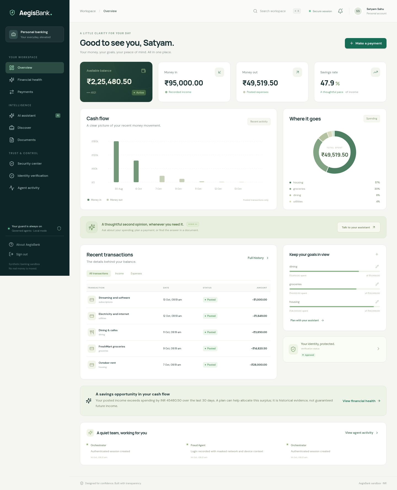

# AegisBank

A runnable, governed agentic banking application with customer and analyst workspaces, configurable **OpenRouter, Gemini, Claude or OpenAI**, proactive financial reviews, identity workflows, cited document answers, recommendations and fraud investigation.

Open the [hosted demo](https://agies-bank.web.app) and choose **Customer demo** or **Analyst demo**. Deployment and further changes use `main`.

## Technology and end-to-end flow

| Layer | Technology and responsibility |
| --- | --- |
| Web | Next.js 15, React 19, TypeScript, responsive customer and analyst workspaces |
| API | Python 3.12, FastAPI, Argon2 passwords, opaque server sessions and CSRF |
| Storage | Firestore Native; atomic ledger, transfer, audit and durable-job commits |
| Agents and AI | Scoped specialist tools, four scheduled reviews, OpenRouter/free and optional Gemini/Claude/OpenAI |
| Documents | pypdf/text extraction, tenant-scoped lexical retrieval and checked citations |
| Hosting | Firebase Hosting → Cloud Run web/API; Cloud Scheduler → finite worker job |
| Delivery | GitHub Actions checks, keyless Google identity, Cloud Build and Artifact Registry |

The customer signs in, reads a Firestore-backed overview, manages budgets/goals,
queries documents and reviews assistant proposals. A confirmed transfer passes
server risk checks before atomic settlement, a password challenge or an analyst
hold. Committed events queue durable reviews; schedules continue when the API
scales to zero. The analyst resolves cases and checks ledger reconciliation.
See [complete flows](docs/END_TO_END.md) and [architecture](docs/ARCHITECTURE.md).

Banking, identity/sanctions, bureau and geo/device providers use explicit synthetic adapters, as requested. No real money moves. AI keys enable the implemented model-assisted capabilities; they do not establish a real bank or legal identity-provider connection.



## Run on your computer

Install **Python 3.12+** and **Node.js 24 LTS** (includes npm). Then:

```bash
git clone --branch main https://github.com/satyamsahu40678/agies-bank.git
cd agies-bank
python scripts/run-local.py --setup --open
```

On macOS/Linux use `python3` if `python` is not installed. On Windows you can use `py -3`. The launcher installs hash-verified Python and npm-lock dependencies, starts the API/web app, and opens your computer's browser. It stops both services on Ctrl+C. Subsequent starts omit `--setup`.

The app uses web port 3000 and API port 8000. Logs are in `logs/`. The local launcher uses loopback only. This cloud workspace cannot directly control your personal computer; run the commands on the computer where you want to view the app.

For development with uv/make:

```bash
make setup
make dev
```

Local launchers use disposable in-memory data by default. For persistent local data, use the Firestore emulator with `docker compose up --build -d`, or configure a Firestore development project. Hosted mode always requires Firestore. See [operations](docs/OPERATIONS.md).

## Add Gemini, Claude, OpenAI or OpenRouter

Create or edit the **project-root `.env`**, which is ignored by Git. Enter keys there or in secure backend environment settings; do not put them in chat, browser forms or source code.

```dotenv
AEGIS_AI_PROVIDER=auto
AEGIS_KYC_VISION=auto
# Add a provider key:
GEMINI_API_KEY=
ANTHROPIC_API_KEY=
AEGIS_OPENAI_API_KEY=
OPENROUTER_API_KEY=
# Optional model override:
GEMINI_MODEL=
OPENROUTER_MODEL=openrouter/free
```

Restart the backend after editing. Automatic mode selects a configured provider for chat/tools and document synthesis. Precedence is Claude, OpenAI, OpenRouter, then Gemini; set `AEGIS_AI_PROVIDER` to `gemini`, `openai`, `claude` or `openrouter` to choose. OpenRouter defaults to `openrouter/free`; route availability and tool calling vary and can change. OpenRouter is not used for KYC image review. Set `local` to run without model calls. `AEGIS_AI_MODE` remains a compatibility setting, and `AEGIS_KYC_VISION` can override the image-assessment provider independently.

OpenRouter rate limits, outages and timeouts use the scoped local assistant, with
a visible notice and `ai_mode=local` on that response. Document fallback keeps
the retrieved source passages. Invalid citations, missing required tool calls
and rejected credentials remain errors. A validated transfer proposal uses
server-authored consent text and requires a separate confirmation.

`GOOGLE_API_KEY` is accepted as a Gemini alias. Local `OPENAI_API_KEY` is accepted as an alias. Optional model overrides are `GEMINI_MODEL`, `ANTHROPIC_MODEL`, `AEGIS_OPENAI_MODEL` and `OPENROUTER_MODEL`; otherwise the app discovers a supported model where implemented. Gemini uses Google's native `generateContent` function calling and sends credentials in an API-key header, not a URL. OpenRouter uses its OpenAI-compatible chat completions API. Allow `generativelanguage.googleapis.com`, `openrouter.ai`, `api.anthropic.com` and/or `api.openai.com` when running behind restricted egress.

The analyst **Integrations** page shows implemented adapters, effective modes and credential presence without revealing values. Connection buttons check model/catalog access without sending customer data; that does not prove inference succeeds. Supplied keys still need valid account permissions, quota and network access. Do not use credentials pasted into chat or source code; revoke and rotate them immediately.

## Google Cloud deployment

Firestore is authoritative for all application data. Cloud Run hosts the API and Next.js; Firebase Hosting provides the public HTTPS entry point. Cloud Scheduler runs durable review jobs independently of the API. The production image has no SQLAlchemy, Alembic or PostgreSQL dependency.

```bash
export GOOGLE_CLOUD_PROJECT=agies-bank
export DEPLOY_MODE=demo
bash scripts/deploy-google.sh
```

Run the one-time owner setup first, with an enabled `AGIES_SECRET` version and optional `OPENROUTER_API_KEY` in Secret Manager. The script verifies the hosted demo before reporting a public URL. See [cloud setup](docs/CLOUD_SETUP.md) for identities, exact commands, offline SQLite import and the deployment verification record. The previous 99-row SQLite file is not in this checkout and has not been imported into the live project.

Routine deployments use a **read-only schema check**. For the first rollout to
an empty database, explicitly set `INITIALIZE_SCHEMA=true`; historical imports
and schema upgrades require offline maintenance with writers stopped.

## Automatic deployment from main

Push application changes to `main` as usual. **Application checks** runs backend,
native Firestore, build, security, dependency and browser checks. A successful
check of the current `main` commit triggers **Deploy Firestore application**,
which publishes that exact commit and verifies the public app. Failed checks
leave the existing deployment running. Pull requests and other branches do not
deploy. Older commits are skipped when a newer `main` push exists.

One-time Google trust setup is in
[scripts/bootstrap-github-actions.sh](scripts/bootstrap-github-actions.sh).
It must be run by the project owner; no JSON key or provider token is placed in
GitHub. Project-specific nonsecret identity defaults are already in the workflow.
See [CI/CD setup, release status and recovery](docs/CICD.md) for the executed
status and the owner command.

## Demo sign-ins

| Role | Email | Password |
| --- | --- | --- |
| Customer | `customer@aegis.demo` | `AegisDemo!2026` |
| Analyst | `analyst@aegis.demo` | `AegisAnalyst!2026` |

These credentials are intentionally public synthetic demo credentials. Production startup rejects a database containing them. Newly registered customers start with zero balance, and public registration cannot grant the analyst role.

## What is implemented

- **Customer overview and payments:** persisted balances, complete monthly totals, transaction history, beneficiaries, explicit payment review, atomic double-entry settlement, replay protection and no overdrafts.
- **Financial health:** proactive scoped tools review posted activity, cash flow, budget pressure, subscriptions, identity status, affordability and savings plans.
- **Savings goals:** manual planning progress, target dates, contribution estimates and pause/completion controls; goals never debit or reserve money.
- **Durable agents:** persistent queue, event deduplication, atomic leases, bounded retries/crash recovery, tool scopes, decision summaries and run visibility. Agents propose; financial mutations remain governed.
- **Assistant:** balance/spend/budget/affordability/policy tools, Gemini/Claude/OpenAI/OpenRouter loops, exact citations and consent-required payment proposals.
- **Identity:** bounded ID/selfie uploads, evidence hashes, synthetic screening, transparent risk reasons and analyst review; optional model vision assists evidence quality without asserting legal identity or liveness.
- **Document intelligence:** searchable PDF/text/Markdown/CSV upload, tenant isolation, grounded answers, exact source passages and preview.
- **Recommendations:** loan and term-life rule explanations, eligible/blocked states and precise EMI calculations. No real credit or insurance is issued.
- **Security:** statistical/amount/velocity/new-recipient signals, synthetic device/VPN/geo history, calculated impossible-travel checks, customer alerts, transfer holds and analyst cases.
- **Analyst operations:** approve/reject with reasons, atomic balance rechecks, freeze/unfreeze, audit evidence, integration checks and explicitly confirmed shared-policy publication.
- **Deployment safeguards:** expiring authenticated sessions, CSRF/origin checks, upload bounds, append-only ledger/audit guards, migrations, production configuration refusal, secure analyst provisioning and CI workflow.
- **Automations:** configurable financial reviews, security watch, document readiness and savings coaching; enable/pause/run controls, durable schedules and run history.
- **Google Cloud:** Firestore-primary storage, Cloud Run API/web/jobs, Firebase Hosting, scheduled recovery, distinct service identities, secure cookies and deny-by-default client rules.

## Demo journey

1. Sign in as the customer; open Financial health to see the background agent's review and run trace.
2. Create a savings goal and confirm that your balance does not change.
3. Ask the assistant about spending, loan eligibility or a policy; inspect executed tools/citations.
4. Upload a document or sample KYC evidence from [examples](examples/README.md).
5. Send a routine payment; a larger new-recipient payment asks for password re-authentication.
6. Simulate impossible travel and a large payment in Security; funds are held before settlement.
7. Sign in as the analyst, inspect the case and approve/reject it with a reason.
8. Open Automations to schedule a security or savings review; inspect the trace and insights.
9. As an analyst, open Operations to reconcile balances and inspect worker health; use Integrations for provider checks.

## Test and inspect

The backend suite has passed both in isolation and against the actual Firestore emulator; Next.js has built successfully. See [validation](docs/VALIDATION.md) for current counts and separate browser, HTTP, live-cloud and container outcomes.

```bash
make check
make test-firestore
backend/.venv/bin/python -m unittest discover -s tests/acceptance -v
# With a fresh disposable demo API/web instance running:
npm run test:e2e --prefix frontend
```

Install a Playwright browser with `cd frontend` then `npx playwright install chromium`, or set `PLAYWRIGHT_CHROMIUM_EXECUTABLE` to an installed compatible browser.

Browser journeys change banking/security state and require a fresh synthetic database. Retained suspicious events correctly change later risk decisions; do not disable those safeguards to force a repeat test to pass. CI starts from an empty database. See [validation](docs/VALIDATION.md) for executed outcomes and limitations.

## What remains for live financial use

The self-contained mock workflow is implemented. Real payment/bank APIs, authoritative KYC/liveness/sanctions, real bureau reports, attested device/GeoIP and enrolled production MFA remain separate provider integrations. They require provider accounts, protocols, consent, reconciliation, operational monitoring and regulatory review. An LLM key cannot provide these services.

Local retrieval is lexical rather than learned vector embeddings. Scanned-PDF OCR, multilingual voice and regulatory reporting are future extensions. Savings-goal progress is manually tracked rather than reserved funds. Hosted HTTPS and secrets are configured; backups/restore drills, privacy/retention controls and real provider validation remain production work. See the prioritized [future ideas](docs/ROADMAP.md).

| Documentation | Contents |
| --- | --- |
| [Delivery status](docs/IMPLEMENTATION_STATUS.md) | Completed features, live configuration and remaining limits |
| [End-to-end flows](docs/END_TO_END.md) | Customer, payment, analyst, identity, documents and agent journeys |
| [Architecture](docs/ARCHITECTURE.md) | Technologies, persistence, atomicity and trust boundaries |
| [CI/CD](docs/CICD.md) | Automatic main deployments, one-time trust setup and recovery |
| [Cloud setup](docs/CLOUD_SETUP.md) | Google identities, hosting, secrets and safe legacy import |
| [Operations](docs/OPERATIONS.md) | Local setup, maintenance, worker and recovery commands |
| [API contract](docs/API_CONTRACT.md) | Endpoints, auth, workflow and fallback response fields |
| [Validation](docs/VALIDATION.md) | Executed checks and live evidence |
| [Requirements](docs/REQUIREMENTS.md) | Agreed scope and acceptance conditions |
| [Roadmap](docs/ROADMAP.md) | Prioritized future ideas and production prerequisites |

```text
backend/       API, persistence, providers, scoped tools, risk rules and tests
frontend/      Customer/analyst web application with self-hosted fonts
tests/         Independent HTTP security and browser acceptance
scripts/       Locked setup, local startup, validation and Docker build helpers
examples/      Synthetic identity and policy upload samples
docs/          Requirements, implementation status, contracts and evidence
```
