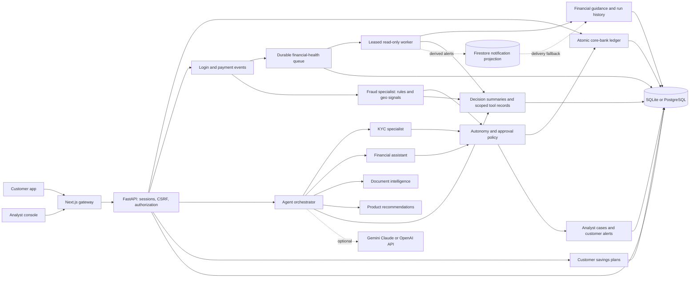

# Architecture and trust boundaries

AegisBank implements the deck's banking story as a persistent, governed application. The core bank, identity verifier, sanctions source and credit bureau use synthetic demo adapters. A working demo is not certification for handling deposits or issuing regulated credit.

## Execution modes

Local mode runs the customer and analyst workflow with deterministic tools and rule explanations and requires no API key. Gemini, Claude and OpenAI modes supplement assistant tool orchestration, document-answer synthesis and optional evidence-quality assessment. The selected model cannot change banking authorization, credit eligibility or settlement rules. The UI, health endpoint and analyst Integrations page identify effective modes and credential presence without returning secrets. Tool output and document text are untrusted data and do not authorize actions.

The backend reads a supported-variable allowlist from the project-root `.env`; already injected values take precedence. Auto mode prefers Claude, then OpenAI, then Gemini when multiple keys exist. Explicit provider/model settings are supported. Claude uses the Messages API; OpenAI uses the Responses API with response storage disabled; Gemini uses Google's native `generateContent` function-calling API. Model discovery uses official read-only metadata endpoints and bounded caches. A successful metadata check proves model access only. Inference still depends on provider account permissions, quota, network access and compatible models; failures are explicit rather than replaced with a fabricated success.

The assistant reads a customer-scoped financial snapshot and can propose a transfer. The customer confirms it through the same transfer API used by the payment screen. It cannot directly move money through generated text. Financial mutations, account freezes, KYC rejection and analyst overrides remain server-governed operations. Audits store concise decision summaries and tool names, never hidden chain-of-thought or passwords.

## Persistence and money

Amounts use integer paise in persistence and decimal INR strings at the API boundary. A transfer settles only after sufficient funds, account status, ownership, current risk and consent checks. Idempotency prevents a retried request from settling again. Step-up and analyst decisions revalidate the current account before execution. A held transfer has not moved funds. Synthetic transaction history provides useful charts and anomaly baselines; newly registered users have zero balances.

SQLite is the zero-infrastructure development path. PostgreSQL is the deployment path and should be used for concurrent workloads, managed backups and recovery. Running processes are disposable; sessions, ledger data, documents, cases and audit records survive server restarts through the database.

## Proactive workflows and planning goals

Login and customer activity stage financial-health jobs in the same database transaction as the event. Event keys deduplicate repeated work, stale dashboard reads reuse recent reviews and manual refresh starts a new review once prior work completes. The API lifecycle starts an in-process polling worker; database-backed runs survive process restarts.

Atomic claims assign lease tokens and bounded attempts. PostgreSQL skips locked work and serializes jobs for one customer. A worker commits its claim before processing, then commits insights and run completion atomically behind the current lease token. Failed work rolls back proposed outputs, retries with a bounded delay and eventually becomes failed. Expired leases recover; an old token cannot publish completion. Multiple API workers share the queue without requiring a separate broker.

When `FIRESTORE_AGENT_NOTIFICATIONS=true`, a successful SQL commit is followed by a best-effort Firestore projection of derived customer insights. Customer path segments are HMAC-derived, only the owning authenticated customer can retrieve the matching projection through the API, and Firestore client rules deny direct client access. A Firestore outage cannot roll back a financial workflow; the API falls back to SQL. Cloud Run metadata-server identity tokens are used instead of service-account key files.

The worker invokes an allowlist of customer-scoped read tools and produces budget, recurring-charge, cash-flow, buffer, goal, affordability and identity guidance. It makes no model request for every event. Financial totals and budget usage cover the complete posted ledger for the last 30 days. Recurring detection examines at most 10,000 entries over 120 days and labels forecasts as estimates. Run records expose tool names, concise decisions, retry state and trace IDs. They contain no hidden model reasoning.

Savings goals store integer-paise targets and manually entered saved amounts, optional deadlines and status. Suggested monthly contributions compare all active goals against historical cash-flow surplus. A goal creates no ledger entry, holds no balance and reserves no funds. The worker cannot transfer money, modify budgets, approve identity, freeze accounts or release a case; its output remains guidance requiring customer or analyst action.

## Identity and documents

Demo KYC uses submitted structured fields, ID/selfie uploads and a synthetic sanctions list. This is visibly labelled; it is not proof of identity, liveness or an authoritative sanctions check. Optional Gemini/Claude/OpenAI vision sends the submitted document and selfie to the selected provider for readability, apparent portrait/person presence and transient printed-name extraction. Uploaded evidence can contain private identity information; operators must configure appropriate consent, retention and provider data handling before real use. The extracted name is compared in memory, and the image/provider response is not persisted by this assessment. Structured KYC submissions and evidence hashes remain application records. Passwords, API keys and identity-number fields are excluded from assistant context and audit summaries. Identity/liveness, sanctions and bureau services still require their own integrations.

Document retrieval is local and citation-based. PDF/text/Markdown/CSV uploads are extracted into bounded source chunks, filtered by customer ownership plus shared policy visibility. Optional model synthesis receives bounded redacted excerpts; citations remain server-authored and references outside the retrieved set are rejected. Source previews expose the stored passages to their authorized reader. Authenticated analysts can publish shared policies with explicit confirmation that all customers may read them. Policy publication changes available Q&A evidence, never executable lending or payment rules. Scanned PDF OCR, multilingual speech, learned fraud models, live GeoIP, real payments and regulatory reporting remain extensions.

## Deployment boundary

The deployment script uses Firebase Hosting rewrites to Cloud Run for the public HTTPS/CDN origin; Cloud Run hosts the web and API containers, with Cloud SQL PostgreSQL for transactional state and Firestore as an optional alert projection. Use Secret Manager for the session secret, database URL and model keys. Grant the dedicated Cloud Run identity Cloud SQL Client, Secret Manager Secret Accessor and Datastore User. Run the controlled migration job before API startup or replica scaling. Direct client Firestore access is denied; Cloud Run uses metadata-server credentials and no service-account JSON. Restore backups in staging before relying on them, collect metrics centrally and protect the audit store from privileged database alteration. Append-only database triggers do not protect evidence from a database owner who can alter those guards.

The development threat model includes hostile API clients, cross-customer requests, repeated payments, forged model actions, cross-site requests, malformed document uploads and unauthorized analyst actions. It does not make the demo adapters authoritative bank integrations or guarantee regulatory approval.
