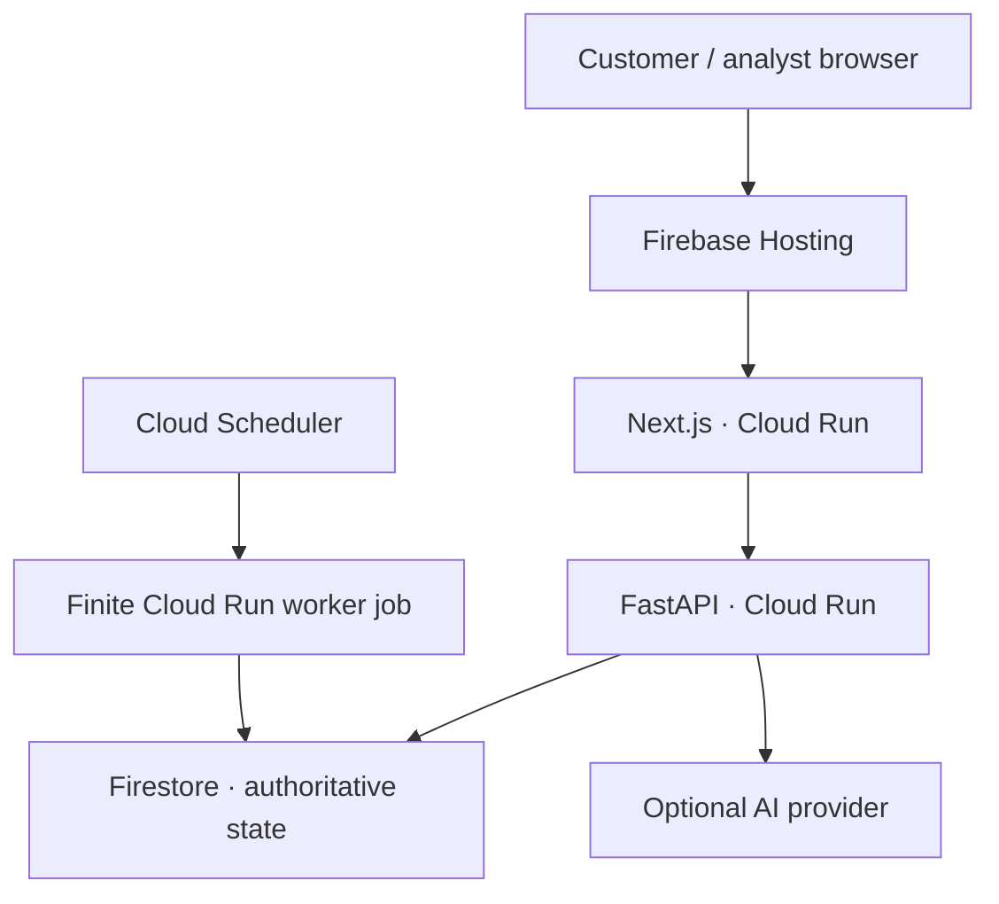

# Architecture and trust boundaries

AegisBank is a synthetic banking prototype with customer and analyst workspaces.
The browser never talks directly to Firestore or a model provider. FastAPI owns
authentication, authorization, risk gates, settlement and document scopes.

## Domain storage

`models.py` contains plain domain records; `query.py` describes Python predicates
and aggregates. Neither imports SQLAlchemy. `db.py` is the Firestore repository
and unit of work. A separate explicit in-memory adapter supports disposable
local demonstrations. Hosted configuration refuses memory or an emulator.
Legacy SQL models/migrations are only used by the read-only import tooling and
are absent from the production dependency lock.

Each application collection keeps its original table name and each record its
original ID, preserving references through migration. Dates are stored as ISO
dates and decoded to Python dates; timestamps are timezone-aware. Money stays
signed 64-bit integer paise, with decimal strings at the API boundary.

## Atomic commit protocol

All point reads and queries observe a collection revision before fetching data.
Writes are staged locally. A native Firestore atomic Commit writes all changed
records together with hashed unique reservations and revision documents.
Last-update-time/create preconditions validate both write versions and every
observed collection revision. A conflict aborts the whole commit. This prevents
lost updates, duplicate unique values and query phantoms. Local business routes
restart with a fresh unit of work after bounded conflicts. External model calls
are not automatically repeated by this route retry.

Transfers commit the customer debit, clearing credit, paired ledger entries,
transfer status, beneficiary update, audit evidence and queued follow-up job
atomically. Unique reservations cover email, account identity, idempotency keys,
ledger transfer/account pairs, jobs, insights and schedules. Conditional status
checks and latest balances protect analyst approvals and password challenges.
Ledger and audit records are append-only through the repository; direct client
writes are denied by Firestore rules. Privileged server/project administrators
can bypass client rules, so these guards are not an immutable external archive.

The current protocol uses collection-wide revisions. It deliberately favors
correctness and a simple verified prototype over high write throughput. Queries
push a tenant/equality filter to Firestore and evaluate remaining predicates,
ordering and exact aggregates over the full matching scope. Large tenant
histories, global analyst views and hot revision documents need partitioned
revision guards, maintained aggregate projections and load testing before large
scale use. An upload is limited to 300 chunks to fit a bounded atomic commit.
There are no truncated samples masquerading as full monthly financial totals.

## Durable agents and schedules

Login, transfer and goal events stage review jobs in their business transaction.
A claim commits a lease and fencing token before execution. Only one active job
per customer is allowed. Output, insights and completion are committed together;
a stale token or expired lease cannot publish completion. Failed executions roll
back output and retry with bounded backoff. Expired final attempts become failed.

Customers can enable, pause and run financial health, security review, document
readiness and savings coaching schedules. A schedule's due timestamp and its
outbox job advance together; competing dispatchers cannot queue it twice. Each
workflow reads only its customer's records, emits guidance and records tools and
decision summaries. It cannot settle payments, modify a budget or approve KYC.
Savings progress remains a planning record, not reserved bank funds.

Cloud Scheduler invokes a finite worker job every five minutes with a service
identity. This supplies recovery independently of API CPU allocation or scale to
zero. Manual review endpoints also attach a bounded response background task.
The development polling thread can be enabled explicitly.

## Authentication and AI boundaries

Argon2 hashes protect passwords. Opaque expiring server sessions use a Secure,
HttpOnly `__session` cookie on hosted environments; Firebase forwards this name.
Mutation requests require an allowed Origin and the session's CSRF token. Public
registration always creates a customer with zero balance; analysts require
operator provisioning. Role and tenant checks apply before document retrieval,
payment execution or model tool access.

Gemini/Claude/OpenAI/OpenRouter are optional server-side adapters. Tool registries
allow only scoped calls; payment proposals still need the customer's separate
confirmation. Document answers cite retrieved evidence. OpenRouter does not
perform image KYC. Synthetic identity, sanctions, bureau, settlement and device
adapters remain labelled as such; model access does not replace them.

## Operations

Firebase Hosting fronts two Cloud Run containers with explicit ports. Secret
Manager supplies `AGIES_SECRET` and optional provider keys. A schema validation
job runs before a fresh rollout; it checks references, uniqueness and ledger
reconciliation. Firestore client rules deny all access. Runtime, build and
scheduler identities have separate roles. Backups, restoration tests and a
privileged audit archive remain deployment/operator responsibilities.
